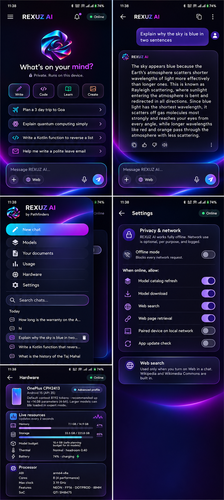

# REXUZ AI

**Your private AI that lives on your phone, not in the cloud.**

Chat · Voice · Live web · Images & video · Documents · Games and files from one message

*Works offline. Learns you. Creates anything.*

**Coming soon on Google Play** · by **Pathfinders**

---

## Why REXUZ AI

Most AI apps send every message you type to a company's servers. REXUZ AI runs the AI model **on your own phone**. Your chats are answered on the device and stored on the device, encrypted. There's no account, no login and no phone number.

When you're online, REXUZ AI goes further: its built-in **web brain** looks up today's news, prices, scores and new releases before it answers. When you're offline, it keeps working.

---

## Features

### 🔒 Private by design
- The AI runs on your phone, so your messages aren't sent to a server to be answered
- Chats, memories and documents are kept in an encrypted database
- Encrypted backup with your own password, for moving to a new phone
- No account, no sign-up, no phone number
- Every network request has a purpose, can be switched off, and is logged where you can see it

### 🌐 Web brain: knows what's happening today
- AI models only know the world up to their training date. REXUZ AI fills that gap with the live web
- Questions about news, prices, matches, launches or anything recent are searched automatically, with no button to press
- It reads the best pages, not just headlines, and shows the sources so you can tap through and check
- Small talk, writing, code and maths stay on the phone, with no search needed
- One switch (Offline mode) turns all network use off

### ✈️ Works offline
- Chat on a flight, in the metro, or in a village with no signal
- Voice typing and read-aloud work offline too

### 🧠 Learns you, and only you
- Remembers what you tell it: *"I'm a student"*, *"I live in Pune"*, *"call me Sam"*
- Follows your rules in every chat: *"never use emojis"*, *"always answer in Hindi"*
- Learns your style: short or detailed, simple or technical, points or paragraphs
- Learns from its mistakes: say *"that's wrong"* or tap 👎 and it won't repeat it
- Tap 👍 on answers you like and you'll get more like them
- Everything it learned is listed in Settings, and you can delete any item
- Each person's REXUZ AI learns only from them, on their own phone

### 🛠️ Creates anything
- *"Make a tic tac toe game"* gives you a game you can play right inside the app
- Calculators, quizzes, to-do lists and small web apps
- PDFs, Word documents, spreadsheets and code (Python, Kotlin, JavaScript and more)
- Save or share every file
- If a game has a bug, tap **Fix it** and REXUZ AI repairs it

### 🎨 Pictures and video
- Create images from a description, on your phone
- Edit a photo, or start from a reference picture
- Ask questions about a photo
- Short AI videos on powerful phones

### 🎙️ Voice
- Speak instead of typing: English, Hindi and many more languages
- Answers can be read aloud

### 📄 Your documents
- Add PDFs, notes or text files and ask questions about them
- Answers show where in the document they came from

### 📱 Made for your phone
- Checks your phone and marks every AI model as **Recommended** or **Not recommended**, with the minimum RAM and storage it needs
- Picks a good model for each task automatically
- Long chats don't lose track: older messages become memory instead of being forgotten
- A fast, dark neon design

---

## ⭐ REXUZ Pro

REXUZ AI is **free**. **REXUZ Pro** is an optional upgrade for people who want the most powerful features. It's still private and still runs on your phone.

| | REXUZ AI (free) | REXUZ Pro |
|---|:---:|:---:|
| Private, on-device AI chat | ✅ | ✅ |
| Web brain (live news and facts) | ✅ | ✅ |
| Voice, documents, creating files and games | ✅ | ✅ |
| Learns your facts, style and corrections | ✅ | ✅ **Deeper**: more room for what it learns about you |
| AI model size | Small and medium models | **Bigger, smarter models**: up to 12 billion parameters on capable phones, for better answers, code and games |
| Understands pictures | Basic | **Top vision models** that look at your photos and answer questions about them |
| Creative freedom | Standard | **Fewer limits** on stories, role-play and image prompts (18+) |
| Image and video quality | Standard | **Higher-quality** image and video models and settings |
| Ads | With ads | **No ads**: a clean, distraction-free app |
| New features | Regular updates | **Early access** before everyone else |

> REXUZ Pro will be available as an in-app purchase. Everything in the free app stays free.
> Pro is not distributed through this repository.

---

## How REXUZ AI compares

| | Typical cloud AI apps | REXUZ AI |
|---|---|---|
| Where the AI runs | On company servers | On your phone |
| Internet | Needed for every message | Optional: works offline, uses the web when it helps |
| Account | Usually required | None |
| Your chats | Stored on their servers | Encrypted, on your phone |
| Learning you | Stored in their cloud | On your phone, and you can delete any item |
| Games and files | Some apps, online only | Yes, offline, with in-app play and **Fix it** |
| Cost | Often a monthly subscription | Free, with an optional Pro upgrade |

*An honest note: very large cloud models are stronger at the hardest questions than any model that fits on a phone. REXUZ AI's strengths are privacy, offline use, no account, learning you, and creating things.*

---

## Requirements

- An Android phone. The app checks your phone and shows which models suit it; video needs a powerful phone (about 8 GB RAM or more)
- Free storage for the AI models you choose (the app shows the size before you download)
- Internet only to download models and, if you like, for the web brain

---

## FAQ

**Is it really private?**
Yes. Chats are answered by the model on your phone and stored encrypted on your phone. The web brain sends only your search question to the search service, never your chats, and Offline mode turns it off completely.

**Does it work without internet?**
Yes. After you download a model, chat, voice, documents, images and file creation all work offline.

**Where can I get it?**
REXUZ AI is coming soon to Google Play. Star or watch this repository to know when it's out.

**Where is the source code?**
REXUZ AI is closed source. This repository is the official home page for news, releases and feedback.

---

## Feedback

Found a bug or have an idea? Open an [issue](../../issues), or email **pathfindersx10@gmail.com**.

**REXUZ AI** by **Pathfinders**: an independent developer building private AI for everyone.

© 2026 Pathfinders. All rights reserved.

